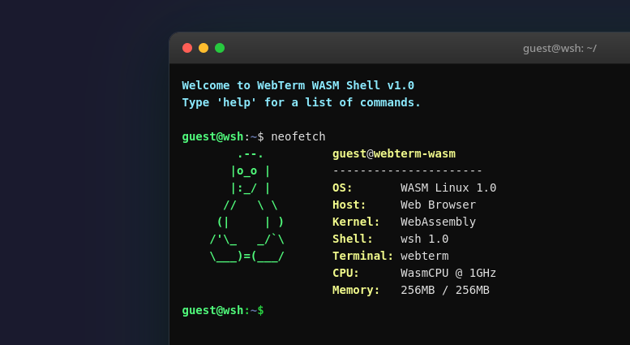
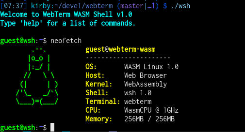

Last weekend, I did play with [Virtual machine][https://virtual-machine.pages.dev/] and it was a cool experience.
(Btw, it emulates a 32 bit x86 computer in software. I did boot alpine linux and `/proc/cpuinfo` showed a Pentium III)
Anyway, once the virtual machine got started, I got - I guess - a 80x25 character large terminal. Which means today
a lot of black area, unless you make the browser window very small or zoom in. (Perhaps there is a setting?) Then I wondered,
how hard can it be to run a C program compiled as WASM in a fake terminal in a browser? No clue - so I asked an LLM to
create an example for me (Great use of LLMs!) And it created [webterm](https://gmelcehtt.github.io/2026-09-19/webterm/index.html)
[source](https://github.com/gmelchett/webterm)

The LLM did overdo it, I though about just a simple echo program, but it did create a fake shell.

Fake "neofetch" executed from a web browser

Fake "neofetch" executed from a terminal

The 'javascript' part could be much smaller, but once the LLM did create a terminal window, I couldn't resist the urge to
ask for maximize, minimize and make it movable.

A cool example, but I don't have any plans in exploring it further. There are plenty of usecases where web browsers are super useful,
but running a terminal is perhaps not one of them.
